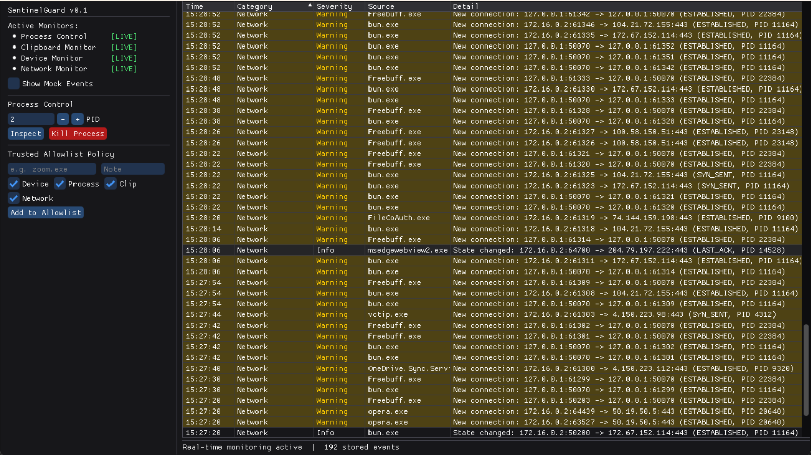
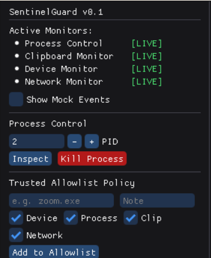

# SentinelGuard

SentinelGuard is a native Windows privacy and activity monitor written in C++20. It runs a set of background
monitors, classifies the events they emit, and streams them into a live Dear ImGui dashboard rendered with
DirectX 11.

It answers the question *"what is my machine doing right now?"* — which process was started, what sensitive
looking text hit the clipboard, which application started capturing from the webcam or microphone, which TCP
connection was opened — and lets you suppress noise per process.

> **Scope.** SentinelGuard is **not** an antivirus or a signature-based malware scanner. It does not scan files,
> inspect on-disk content, hook the kernel, or match hashes against a threat feed. It observes runtime system and
> privacy activity through public Win32 APIs and reports it. No detection verdict it emits is a security
> guarantee.

---

## Overview

| | |
|---|---|
| Language | C++20 (`/std:c++20`, no compiler extensions) |
| Build | CMake ≥ 3.20, MSVC (Visual Studio 2022) |
| UI | Dear ImGui v1.91.6 (fetched via `FetchContent`), Win32 + DirectX 11 |
| Platform | Windows 10 / 11, x64 |
| Warning policy | `/W4 /WX /permissive- /utf-8 /Zc:__cplusplus` on every first-party target |

Live event categories: **Process**, **Clipboard**, **Device**, **Network**.

---

## How It Works

### Pipeline

```
            producers                              consumers
 ┌────────────────────────────┐
 │ ClipboardMonitor           │─┐
 │ DeviceMonitor              │─┼─► EventBus ──► subscriber ──► RingBuffer<AlertEvent, 500> ──► Dashboard
 │ NetworkMonitor             │─┘   (jthread)     (Allowlist     (fixed capacity,            (per-frame
 │ ProcessKiller / Dashboard  │                   filter)        snapshot copy)              snapshot)
 └────────────────────────────┘
```

- **`EventBus`** — a single-consumer publish/subscribe queue. `publish()` is callable from any thread; a
  `std::jthread` drains the queue and invokes subscribers. `stop()` requests the stop token and joins, so no
  callback can run after shutdown begins.
- **`Allowlist`** — the only filter between the bus and the buffer. An `AlertEvent` is dropped when its
  `source` (the process name carried by the event) matches a rule that covers that category.
- **`RingBuffer<AlertEvent, 500>`** — fixed-capacity, overwrite-oldest storage. The dashboard calls `snapshot()`
  once per frame, which copies the live contents under a lock; the UI never holds a reference into the buffer.
- **`AlertEvent`** — plain value type: `timestamp`, `category`, `severity`, `source` (wide string),
  `detail` (wide string). Copied, never shared.

### Milestones

**Milestone 1 — Dashboard shell.** Win32 window with the embedded icon, D3D11 device/swap chain (hardware with
WARP fallback), Dear ImGui host window with no decoration, and the `Dashboard` class: sidebar, sortable and
resizable 5-column event table (Time / Category / Severity / Source / Detail), status bar. Severity rows are
tinted (warning amber, critical red).

**Milestone 2 — Process control.** `ProcessInspector` opens a PID with `PROCESS_QUERY_LIMITED_INFORMATION`,
reads the image name and full path, and flags protected system processes. `ProcessKiller` calls
`TerminateProcess` only when the target is not protected, and reports a structured error otherwise. Both return
`Result<T>` rather than throwing.

**Milestone 3 — Clipboard.** `ClipboardMonitor` registers a clipboard format listener, reads the offered text
under `OpenClipboard` with a **bounded** copy (`GlobalSize` plus NUL search — no over-read on unterminated
handles), and immediately wipes its local copy after classification. `PayloadClassifier` scores plain text for
entropy (Shannon, bits/char), JWT shape, and card-like digit runs to produce `Info` / `Warning` / `Critical`.
Classification is capped at 1M characters.

**Milestone 4 — Devices and allowlist.** `DeviceMonitor` reads the per-user Windows consent store
(`HKCU\Software\Microsoft\Windows\CurrentVersion\CapabilityAccessManager\ConsentStore\webcam` and
`...\microphone`) once per second and detects which applications are currently capturing from the webcam or
microphone. It reports start/stop transitions, plus any session already active at launch, attributed to the
application name holding the device. `Allowlist` stores per-process rules with four independent category flags
(`allowDevice`, `allowProcess`, `allowClipboard`, `allowNetwork`) plus an `allowAll` shortcut, guarded by a
`std::shared_mutex` and persisted to `sentinel_allowlist.txt`.

**Milestone 5 — Network.** `NetworkMonitor` polls `GetExtendedTcpTable(AF_INET, TCP_TABLE_OWNER_PID_ALL)`
every 2000 ms into a growable `std::vector<std::byte>` buffer (16 KiB start, `ERROR_INSUFFICIENT_BUFFER`
resize-and-retry, 4 attempts max). The first scan is a **silent baseline**, so startup does not flood the table
with pre-existing sockets. Only newly observed connections in tracked states are reported (CLOSED, LISTEN,
TIME_WAIT and DELETE_TCB are skipped, as is PID 0), with the owning process resolved to a name so allowlist
rules can suppress them. A connection that later changes state is emitted at `Info` severity.

### Thread and memory safety

- Every monitor owns its own `std::jthread`; `start()` / `stop()` are idempotent and `stop()` joins.
- Shutdown order in `main.cpp` is network → device → clipboard → `EventBus`, so no producer outlives its
  consumer.
- Handles are RAII (`Win32Handle`), COM objects are `ComPtr`, and nothing is `new`-ed for the UI.
- Shared state is guarded: `std::shared_mutex` in `Allowlist` (with a locked internal save path, since
  `std::shared_mutex` is not recursive), `std::mutex` around the ring buffer. The clipboard window handle is a
  `std::atomic<void*>`.
- `<windows.h>` is deliberately kept out of `Dashboard.{hpp,cpp}` and `PayloadClassifier` so UI and
  classification stay testable in isolation.
- First-party code compiles at `/W4 /WX`, so a new warning is a build failure.

### Repository layout

```
SentinelGuard/
├── assets/
│   ├── sentinelguard.ico        # application icon (16-256 px)
│   └── screenshots/             # README images
├── resources/
│   ├── SentinelGuard.rc         # icon resource script
│   └── resource.h               # IDI_ICON1
├── src/
│   ├── core/
│   │   ├── AlertEvent.hpp       # event value type + severity/category enums
│   │   ├── Allowlist.{hpp,cpp}  # per-process suppression rules, autosave
│   │   ├── EventBus.{hpp,cpp}   # single-consumer jthread queue
│   │   ├── Result.hpp           # error-or-value return type
│   │   ├── Win32Handle.hpp      # RAII handle wrapper
│   │   └── Win32Utils.hpp       # UTF-8 <-> UTF-16 helpers
│   ├── monitors/
│   │   ├── ClipboardMonitor.{hpp,cpp}
│   │   ├── DeviceMonitor.{hpp,cpp}
│   │   ├── NetworkMonitor.{hpp,cpp}
│   │   └── PayloadClassifier.{hpp,cpp}
│   ├── process/
│   │   ├── ProcessInspector.{hpp,cpp}
│   │   └── ProcessKiller.{hpp,cpp}
│   ├── ui/
│   │   └── Dashboard.{hpp,cpp}
│   └── main.cpp                 # window, D3D11, ImGui, wiring, shutdown order
├── tests/
│   ├── CMakeLists.txt
│   ├── VerifyMilestone2.cpp     # process inspect/kill
│   ├── VerifyMilestone3.cpp     # payload classification
│   ├── VerifyMilestone4.cpp     # allowlist + device + bus
│   └── VerifyMilestone5.cpp     # TCP table parsing + network monitor
├── CMakeLists.txt
└── README.md
```

`third_party/imgui` is fetched on first configure and is git-ignored.

---

## Building, Testing and Running

### Prerequisites

- Windows 10 or 11 (x64)
- Visual Studio 2022 with the **Desktop development with C++** workload (MSVC v143 + Windows SDK)
- CMake 3.20 or newer (the copy bundled with Visual Studio is sufficient)
- Network access on the **first** configure, so `FetchContent` can clone Dear ImGui v1.91.6

### Configure and build (Release)

Run from the repository root:

```powershell
cmake -S . -B build
cmake --build build --config Release
```

If `cmake` is not on `PATH`, use the Visual Studio copy:

```powershell
& "C:\Program Files\Microsoft Visual Studio\2022\Community\Common7\IDE\CommonExtensions\Microsoft\CMake\CMake\bin\cmake.exe" -S . -B build
& "C:\Program Files\Microsoft Visual Studio\2022\Community\Common7\IDE\CommonExtensions\Microsoft\CMake\CMake\bin\cmake.exe" --build build --config Release
```

Artifacts:

- `build\Release\SentinelGuard.exe`
- `build\tests\Release\VerifyMilestone2.exe` … `VerifyMilestone5.exe`

A clean build prints no warnings; `/WX` turns any new one into an error.

### Run the test suites

Each suite is a standalone console program that prints `[PASS]`/`[FAIL]` lines and exits `0` only when every
check passed. Run all four from the repository root:

```powershell
.\build\tests\Release\VerifyMilestone2.exe; $LASTEXITCODE
.\build\tests\Release\VerifyMilestone3.exe; $LASTEXITCODE
.\build\tests\Release\VerifyMilestone4.exe; $LASTEXITCODE
.\build\tests\Release\VerifyMilestone5.exe; $LASTEXITCODE
```

All four must report exit code `0`. Or in one pass:

```powershell
'2','3','4','5' | ForEach-Object { & ".\build\tests\Release\VerifyMilestone$_.exe"; "M$_ exit $LASTEXITCODE" }
```

| Suite | Covers |
|---|---|
| `VerifyMilestone2` | PID inspection, protected-process refusal, kill result reporting |
| `VerifyMilestone3` | Entropy thresholds and boundaries, JWT shape, card-like digits, masking, 1M-char cap |
| `VerifyMilestone4` | Allowlist add/update/remove semantics, case-insensitive replace, persistence, device + bus plumbing |

A suite prints one line per check and returns `0` only when every check passed; any failure exits `1`.
| `VerifyMilestone5` | TCP row parsing, IPv4 formatting, tracked-state filtering, baseline behaviour |

### Launch

Run from the repository root so the allowlist path resolves next to the executable:

```powershell
.\build\Release\SentinelGuard.exe
```

Close the window normally (the title bar **X**). Shutdown stops the network, device and clipboard monitors,
then the event bus, then ImGui and D3D11 — no threads are left running.

### Files generated at runtime

Both are git-ignored; both are safe to delete.

| File | Written by | Purpose |
|---|---|---|
| `imgui.ini` | Dear ImGui | Window layout (sidebar width, table column sizes) |
| `sentinel_allowlist.txt` | `Allowlist` | Your trusted-process rules; created on the first add/remove |

---

## How to Use

### 1. Read the live event table

The right-hand table is the event feed, newest row at the top. Columns are **Time**, **Category**,
**Severity**, **Source** and **Detail**. Amber rows are `Warning`, red rows are `Critical`. Headers are
clickable to sort and the column separators are draggable. The status bar at the bottom shows
`Real-time monitoring active` and the number of stored events (the buffer holds the most recent 500).

The **Source** column names the origin of the event: the owning process for network rows, the application name
for webcam/microphone rows, and the literal `ClipboardMonitor` for clipboard rows (Windows exposes no copying
process through the clipboard format listener). Use it to identify *which* process you are about to inspect or
allowlist; it is a name, not a PID.



### 2. Inspect or kill a process

In the sidebar under **Process Control**:

1. Find the PID. Task Manager → **Details** tab → **PID** column, or
   `Get-Process <name> | Select-Object Id,ProcessName` in PowerShell.
2. Type the PID into the `PID` field (values below 0 are clamped to 0).
3. Click **Inspect**. The panel below shows the image **Name**, the full **Path**, and a status line:
   - green `Status: Terminating Allowed` — an ordinary process,
   - red `Status: PROTECTED SYSTEM` — a critical system process, termination will be refused.
   An unknown, exited, or inaccessible PID reports an error message in amber instead.
4. Click **Kill Process** (red) to terminate a non-protected PID. The outcome is printed below the buttons and
   a `Process` event is published to the bus, so the attempt appears in the event table either way.

### 3. Add allowlist rules

In the sidebar under **Trusted Allowlist Policy**:

1. Type the process name exactly as it appears in the **Source** column into the name field (e.g. `zoom.exe`).
2. Optionally add a short **Note** — it is shown next to the entry and stored in the file.
3. Tick the categories the rule should silence: **Device**, **Process**, **Clip**, **Network**. Each is
   independent; tick only the noise you want gone. A rule with no category ticked suppresses nothing.
4. Click **Add to Allowlist**. The name is matched case-insensitively; adding the same name again updates the
   existing rule in place rather than duplicating it.
5. Entries appear in the scrollable list underneath with an `X` button to remove them. Every add and remove
   writes `sentinel_allowlist.txt` in the working directory, so rules survive a restart.

To silence clipboard noise, add a rule named `ClipboardMonitor` and tick **Clip** — that is the source string
clipboard events carry, since the copying process is not retrievable from the clipboard format listener.



Suppressed categories are filtered inside the bus subscriber: matching events never reach the ring buffer, so
they never occupy one of the 500 slots.

### 4. Mock mode

Tick **Show Mock Events** to render five fixed example rows spanning all four categories instead of live data.
Useful for checking table layout and severity colours without waiting for real activity. Live monitoring
continues in the background; untick to return to the live feed.
